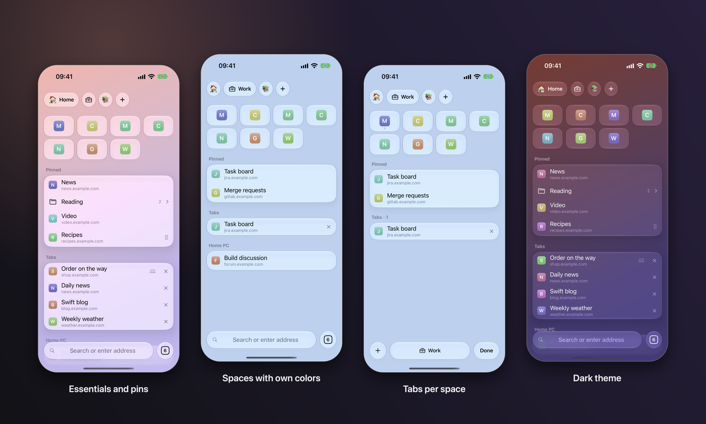
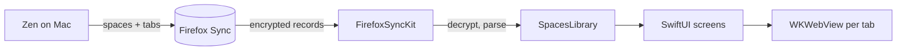

<div align="center">


# Zen for iPhone

**A native SwiftUI browser that brings your Zen Browser Spaces, Essentials and pins to iOS.**


<br>



</div>

<br>

## Why

Zen on the desktop is built around Spaces, Essentials and pinned tabs. On the phone you get none of it. This app closes that gap: sign in once and your workspace shows up on iPhone the way you arranged it on the Mac.

No web wrapper. The interface is fully native SwiftUI with Liquid Glass, the engine is the system WebKit.

> [!NOTE]
> Unofficial personal project. Not affiliated with, endorsed by or sponsored by the Zen Browser team or Mozilla.

## Highlights

| | |
|---|---|
| **Spaces** | Every Space keeps its own name, icon and gradient. The whole screen takes its colors, light and dark |
| **Essentials** | Compact tiles at the top, one tap away, just like on the desktop |
| **Pins and folders** | Pinned tabs and nested folders of the current Space, in the same order as on the Mac |
| **Open on Mac** | Tabs from your other devices, grouped by device |
| **Safari-like browsing** | Floating address bar at the bottom, tab grid, search or URL in one field |
| **Local extras** | Your own Spaces and pins that live only on the phone |
| **Private sign-in** | Password is typed on the Mozilla page, the app never sees it. Tokens live in the Keychain |

## How it works



Zen keeps its workspace in a dedicated `spaces` collection of Firefox Sync. The client is written from scratch in Swift, so there is no Rust, no Glean and no 11 MB of extra binaries:

- **Sign in**: OAuth with PKCE on the Mozilla page inside `WKWebView`, result delivered through WebChannel
- **Keys**: scoped keys unwrapped from JWE (ECDH-ES P-256, A256GCM)
- **Storage**: Hawk-signed requests, records decrypted with AES-256-CBC and checked with HMAC-SHA256
- **Theme**: Zen gradients rebuilt in OKLab so Spaces look like they do on the desktop

The sync layer is a separate Swift package, `FirefoxSyncKit`, covered by tests against the reference vectors for JWE, record crypto and Hawk.

## Project layout

```
Zen/                      the app
  Browser/                tabs, address bar, web containers
  Start/                  Essentials, pins, Space switcher
  Spaces/                 Space model, editor, local library
  Tabs/                   tab grid
  Account/                sign-in sheet, Keychain
  Design/                 favicons, Space backgrounds
Packages/FirefoxSyncKit   Firefox Sync client in pure Swift
```

Every SwiftUI file ships with a `#Preview` on mock data, so any screen can be tuned in Xcode without an account.

## Build

Requirements: Xcode 27, [XcodeGen](https://github.com/yonaskolb/XcodeGen).

```bash
xcodegen generate
```

```bash
xcodebuild -project Zen.xcodeproj -scheme Zen -destination 'platform=iOS Simulator,name=iPhone 17' DEVELOPMENT_TEAM=<your team id> build
```

Run the sync tests:

```bash
cd Packages/FirefoxSyncKit && swift test
```

To explore the interface without signing in, launch with the `-demo` argument. The app starts on mock Spaces, Essentials and tabs.

> [!TIP]
> Build with signing enabled. With `CODE_SIGNING_ALLOWED=NO` `WKWebView` loads blank pages in the simulator.

## Status

- [x] Sign in with a Firefox account
- [x] Spaces, Essentials, pins, folders, split views
- [x] Tabs from other devices
- [x] Tab grid, floating address bar, light and dark
- [ ] Registering the iPhone as a device and publishing its own tabs
- [ ] Send Tab
- [ ] Sign in by QR
- [ ] Ad blocking with content rule lists

The client is read-only for now: it never writes to your sync data.

## Stack

`Swift 6` · `SwiftUI` · `Liquid Glass` · `WebKit` · `CryptoKit` · `Keychain` · `XcodeGen` · `Swift Testing`
